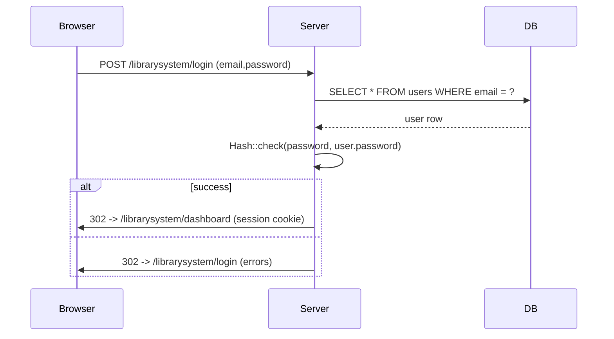
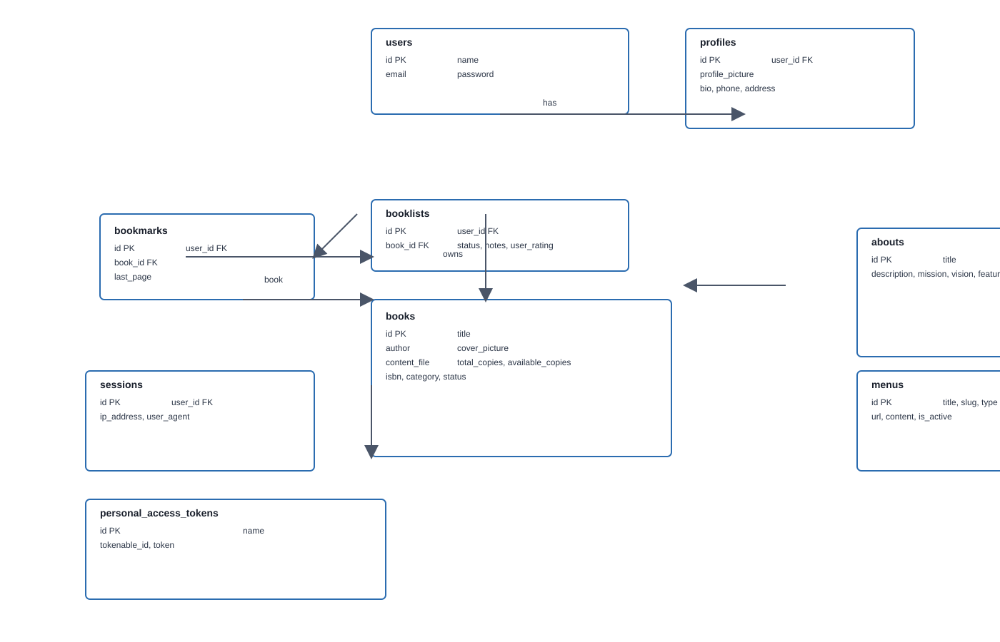
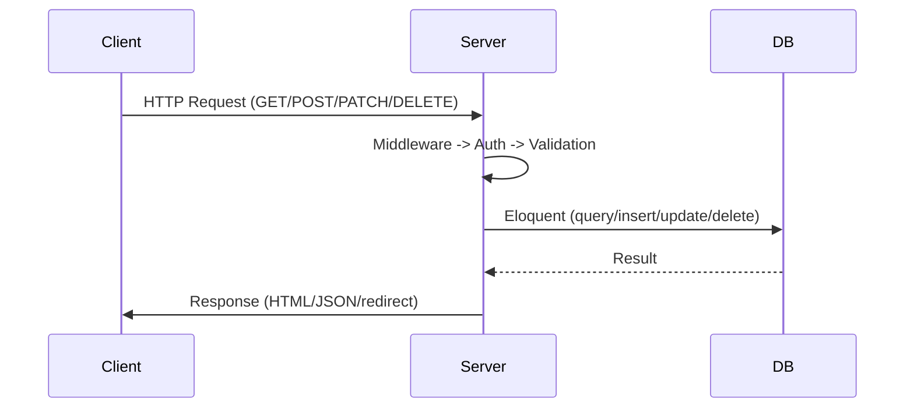
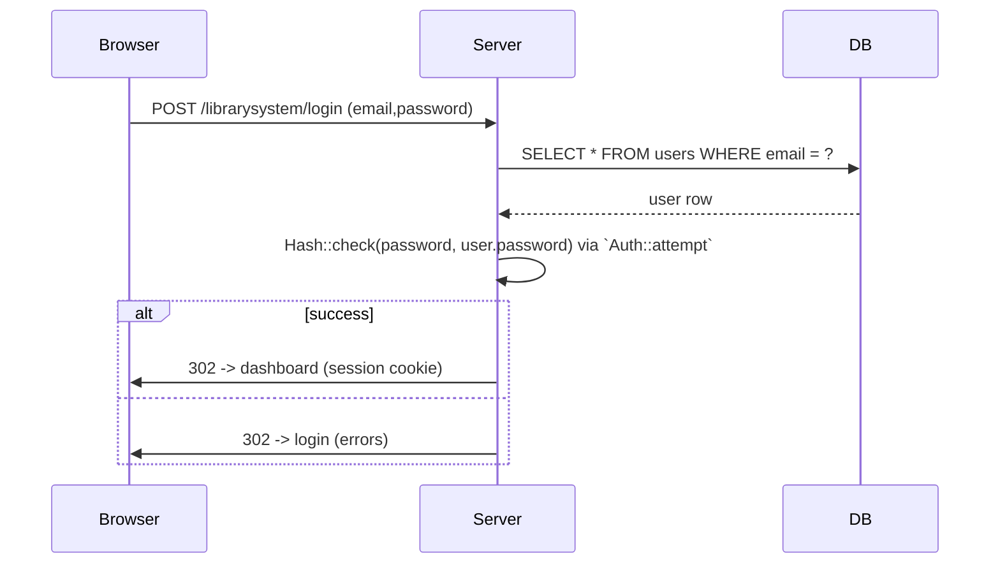

# Client–Server Documentation (Library Management System)

## Overview
This document describes the client–server architecture, database schema, ERD, request flows, and security considerations for the Library Management System.

## System Components
- Client: Browser (Blade views, CSS, JS) or API clients (mobile/web apps) making HTTP requests.
- Server: Laravel application (controllers, middleware, policies) running PHP and providing web and API endpoints.
- Database: MySQL/MariaDB (configured via `.env` and `config/database.php`).
- Storage: Local `storage/app/public` used for uploaded files (covers, content files).

## Architecture & Flow
- Client sends requests (GET/POST/PUT/DELETE) to the server.
- Server authenticates/authorizes via middleware and policies.
- Controller handles request, validates with FormRequests or validator, performs DB operations (Eloquent), and returns HTML or JSON.
- File uploads are stored via `Storage` facade on the `public` disk.

### Sequence: Login (simplified)


## ERD (Mermaid)
```mermaid
erDiagram
    USERS {
        integer id PK
        string name
        string email
        string password
        timestamps
    }
    PROFILES {
        integer id PK
        integer user_id FK
        string bio
        timestamps
    }
    BOOKS {
        integer id PK
        string title
        string author
        text description
        string cover_picture
        string content_file
        decimal rating
        integer total_copies
        integer available_copies
        string isbn
        string publisher
        integer publication_year
        string category
        timestamps
    }
    BOOKLISTS {
        integer id PK
        integer user_id FK
        integer book_id FK
        enum status
        text notes
        decimal user_rating
        timestamps
    }

    USERS ||--o{ PROFILES : has
    USERS ||--o{ BOOKLISTS : owns
    BOOKS ||--o{ BOOKLISTS : listed_in
```



## Database Schema (key tables)
- `users` (default Laravel users)
- `profiles` (user profile data)
- `books` (see migration `2025_12_08_064114_create_books_table.php`):
  - `id`, `title`, `author`, `description`, `cover_picture`, `content_file`, `rating`, `total_copies`, `available_copies`, `isbn`, `publisher`, `publication_year`, `category`, `language`, `pages`, `status`, `timestamps`
- `booklists` (see migration `2025_12_09_172831_create_booklists_table.php`):
  - `id`, `user_id`, `book_id`, `status`, `notes`, `user_rating`, `timestamps`

## Database Connection
- Config: `config/database.php` selects connection via `DB_CONNECTION` in `.env` (e.g., `mysql`).
- Example `.env` values:
```
DB_CONNECTION=mysql
DB_HOST=127.0.0.1
DB_PORT=3306
DB_DATABASE=library_db
DB_USERNAME=root
DB_PASSWORD=
```
- Run migrations and seeders: `php artisan migrate` and `php artisan db:seed`.

## Example: Create Book (Client -> Server -> DB)
1. Client: POST `/books` with form data (title, author, cover_picture, content_file, total_copies...)
2. Route: `Route::resource('books', BookController::class)` maps POST to `BookController@store`.
3. Server: Validation (in-controller or `StoreBookRequest`), then file handling and `Book::create($validated)`.

Snippet (from `app/Http/Controllers/BookController.php` store method):
```php
$validated = $request->validate([
    'title' => 'required|string|max:255',
    'author' => 'required|string|max:255',
    'cover_picture' => 'nullable|image|mimes:jpeg,png,jpg|max:2048',
    'content_file' => 'nullable|file|mimes:txt|max:10240',
    'total_copies' => 'required|integer|min:1',
    'available_copies' => 'required|integer|min:0',
]);

if ($request->hasFile('cover_picture')) {
    $validated['cover_picture'] = $request->file('cover_picture')
        ->store('uploads/books/covers', 'public');
}

$validated['status'] = $validated['available_copies'] > 0 ? 'available' : 'unavailable';
$book = Book::create($validated);
```

## API Endpoints (selected)
- `GET /api/books` (filtering & pagination) — `BookController@apiIndex`
- `GET /api/books/{book}` — `BookController@apiShow`
- `PATCH /api/books/{book}/rating` — `BookController@updateRating`
- `GET /books/{book}/download` — `BookController@downloadContent`

(See `routes/web.php` and `routes/api.php` for full mapping.)

## Validation & Form Requests
- Server-side validations are implemented using `Request::validate()` or Form Requests in `app/Http/Requests/` (e.g., `StoreBookRequest`, `UpdateBookRequest`).
- Client-side: pages include minimal JS checks (e.g., login form) but rely on server validation as authoritative.

## Security Considerations
- CSRF: Blade forms include `@csrf` token; POST/PUT/DELETE routes protected.
- Authentication: password hashing via `Hash`, session management, and route middleware (`auth`).
- Authorization: `Policy` classes and `role` middleware enforce access control.
- File uploads: validated by MIME/type and stored on `public` disk; server checks and deletes old files on update/delete.
- Database safety: Eloquent queries use bound parameters; migrations define column constraints and indices.
- API auth: use `auth:sanctum` for protected API routes where needed.

## Error Handling & Resilience
- Controllers use aborts (e.g., `abort(404)`) and validation exceptions to return appropriate responses.
- Configure `APP_DEBUG` in `.env` for development; set `APP_DEBUG=false` in production.

## Observability & Maintenance
- Logs: Laravel logs in `storage/logs/`.
- Jobs/Queues: migrations include `jobs` table; use queues for longer tasks if needed.
- Backups: schedule DB dumps and storage backups (not included in this repo).

## Useful Commands
- `composer install`
- `cp .env.example .env` and set DB values
- `php artisan key:generate`
- `php artisan migrate --seed`
- `php artisan serve` (development server)

---

## 1. PROJECT PROPOSAL

### 1.1 Project Overview
- Brief description: A Library Management System to manage books, readers, and reading lists. It supports CRUD for books, user profiles, bookmarks, and personal booklists.
- Type of system: Inventory / catalog with user management and content delivery (library system).
- Purpose: Streamline library operations and provide users with tools to discover, read, bookmark, and manage books.
- Problems addressed: Manual inventory tracking, inefficient catalogue lookups, and lack of an online reading/listing interface.
- Client–server architecture: Clients (browsers or API consumers) communicate via HTTP with a Laravel server that handles auth, validation, persistence (Eloquent), and file storage.

### 1.2 Objectives of the System
- Provide a secure authentication system with role-based access.
- Offer a book catalog with metadata, cover art, and downloadable content.
- Allow users to maintain personal booklists and bookmarks.
- Provide administrative tools for staff to manage content and site details.

### 1.3 Target Users
- Library staff (librarians, admins) — manage content and users.
- Library patrons/students — browse, read, and manage personal booklists.
- Site administrators — manage system-level settings and users.

### 1.4 Scope and Limitations
- Scope: Book management (create/read/update/delete), user registration and authentication, bookmarks, booklists, admin pages for content and menu management, REST API endpoints for book resources.
- Limitations: No payment gateway, limited file type support (txt content in repo), no OCR or advanced search, limited concurrency controls.

## 2. SYSTEM DESIGN

### 2.1 System Architecture (Client–Server Model)
- Client: Blade HTML/CSS/JS pages, or API clients.
- Server: Laravel PHP app handles business logic, validation, and persistence.

Client–Server Workflow Diagram (simple):



Request–Response Flow (Login example):



Explanation of communication:
- The client sends form-encoded POST or query-string GET requests.
- Server authenticates using Laravel's `Auth` facade, validates input, and returns redirects or JSON responses depending on the route type.

Source & implementation (files):
- `routes/web.php`, `routes/api.php` — route definitions and resource mappings.
- `app/Http/Controllers/` — main controllers handling requests (e.g., `AuthController.php`, `BookController.php`, `BooklistController.php`).
- `app/Http/Middleware/RoleMiddleware.php` — role-based middleware that gates routes (registered in `bootstrap/app.php`).
- `resources/views/` — Blade templates that render the client HTML (e.g., `auth/login.blade.php`, `books/bookindex.blade.php`).
- `config/database.php` & `.env` — database driver and connection settings.
- `storage/` and `public/` — uploaded file storage and public assets (served via `storage:link`).

Example trace: request -> `routes/web.php` -> middleware (`auth`/`role`) -> `BookController@index` -> `Book::query()` -> `view('books.bookindex')`.

### 2.2 Database Design
- ERD: (see ERD above and linked SVG in this doc)
- Main tables: `users`, `profiles`, `books`, `booklists`, `bookmarks`, `abouts`, `menus`, `sessions`, `personal_access_tokens`.

## 3. DEVELOPMENT PHASE

### 3.1 Tools and Technologies Used
- Frontend: HTML, CSS, JavaScript (Blade templates)
- Backend: PHP (Laravel)
- Database: MySQL / MariaDB
- Server: XAMPP / WAMP / Laragon
- Code Editor: VS Code
- Version Control: Git/GitHub (optional)

NAME | ROLE
---|---
[Your Name] | [Your Role]

### 3.2 File and Folder Structure
A concise project folder tree (top-level):

```
library_system/
├─ app/
│  ├─ Http/Controllers/
│  ├─ Models/
│  └─ Policies/
├─ database/
│  ├─ migrations/
│  └─ seeders/
├─ public/
│  ├─ css/
│  └─ js/
├─ resources/
│  └─ views/
├─ routes/
│  ├─ web.php
│  └─ api.php
├─ storage/
└─ CLIENT_SERVER_DOCUMENTATION.md
```

- To capture a screenshot of the project folder: open Explorer at project root and use the OS screenshot tool (or run `tree /A /F` in PowerShell and capture the window).

### 3.3 PHP Code Structure and Explanation
- Controllers: Business logic for resources (e.g., `BookController`, `AuthController`).
- Models: Eloquent models for DB entities (e.g., `Book`, `Booklist`).
- Policies & Middleware: Authorization (`BookPolicy`, `RoleMiddleware`).
- Requests: Validation using `FormRequest` classes or inline `$request->validate()`.

Source & examples (files):
- Controllers: `app/Http/Controllers/BookController.php`, `app/Http/Controllers/AuthController.php`, `app/Http/Controllers/BooklistController.php`, `app/Http/Controllers/AboutController.php`.
- Models: `app/Models/Book.php`, `app/Models/Booklist.php`, `app/Models/Profile.php`.
- Policies: `app/Policies/AboutPolicy.php`, `app/Policies/ProfilePolicy.php`, `app/Policies/BookPolicy.php`.
- Middleware: `app/Http/Middleware/RoleMiddleware.php` (registered in `bootstrap/app.php`).
- Validation Requests: `app/Http/Requests/StoreBookRequest.php`, `UpdateBookRequest.php`, `StoreProfileRequest.php`, `UpdateAboutRequest.php`.
- Views: `resources/views/books/*`, `resources/views/auth/*`.

#### 3.3.1 Database Connection
- Config: `config/database.php` chooses the driver using `DB_CONNECTION` from `.env`.
- Example snippet:

```php
// config/database.php excerpt
'mysql' => [
    'driver' => 'mysql',
    'host' => env('DB_HOST', '127.0.0.1'),
    'port' => env('DB_PORT', '3306'),
    'database' => env('DB_DATABASE', 'laravel'),
    'username' => env('DB_USERNAME', 'root'),
    'password' => env('DB_PASSWORD', ''),
    // ...
],
```

- Error handling: Laravel surfaces DB errors as exceptions; use `APP_DEBUG` in `.env` for development to see stack traces.

Source files & migrations:
- `config/database.php` (connection and driver settings).
- `.env` (project-specific credentials: `DB_CONNECTION`, `DB_HOST`, `DB_DATABASE`, `DB_USERNAME`, `DB_PASSWORD`).
- Migrations in `database/migrations/` — e.g., `2025_12_08_064114_create_books_table.php`, `2025_12_09_172831_create_booklists_table.php`, `2025_12_11_005708_add_content_file_to_books_table.php`.
- Example usage: Eloquent model classes in `app/Models/` (e.g., `Book.php`) map directly to DB tables and are the primary abstraction for DB operations.

#### 3.3.2 Authentication Module
- Login process: `routes/web.php` maps POST `/librarysystem/login` to `AuthController@login`.
- Relevant code (from `AuthController`):

```php
$validated = $request->validate([
    'email' => 'required|email',
    'password' => 'required|string'
]);

if (Auth::attempt($validated)) {
    $request->session()->regenerate();
    if (Auth::user()->role === 'super_admin') {
        return redirect()->route('show.admin');
    }
    return redirect()->route('show.home');
}

throw ValidationException::withMessages([
    'credentials' => 'Sorry, incorrect credentials',
]);
```

- Session handling: Laravel handles sessions via configured driver; `session()->regenerate()` prevents fixation.
- Access restrictions: `auth` middleware and `role:librarian` guard specific routes.

Source files (auth):
- `routes/web.php` (login/register/logout routes)
- `app/Http/Controllers/AuthController.php` (login, register, logout flow)
- `app/Http/Controllers/ForgotPasswordController.php`, `ResetPasswordController.php` (password reset via `Password` facade)
- `config/auth.php` and `config/session.php` (auth/session configuration)
- Views: `resources/views/auth/login.blade.php`, `resources/views/auth/register.blade.php`, `resources/views/auth/forgot-password.blade.php`, `resources/views/auth/reset-password.blade.php`

#### 3.3.3 CRUD Operations (Book example)
- Create: `BookController@store` validates, handles file uploads, sets `status`, and calls `Book::create()`.
- Read: `BookController@index` paginates and filters; `show` returns details.
- Update: `BookController@update` validates and updates record and files (deletes old files via `Storage`).
- Delete: `BookController@destroy` removes files and deletes the DB row.

Source files (CRUD example):
- Controller: `app/Http/Controllers/BookController.php` (store, index, show, update, destroy — file handling uses `Storage` facade).
- Model: `app/Models/Book.php` (helpers: `hasContentFile()`, `readContent()`, casts/attributes).
- Views: `resources/views/books/create.blade.php`, `editbook.blade.php`, `bookindex.blade.php`, `bookdetail.blade.php`, `readbook.blade.php`.
- Migrations: `database/migrations/2025_12_08_064114_create_books_table.php`, `2025_12_11_005708_add_content_file_to_books_table.php`.
- Notes: File uploads are stored under `storage/app/public/` and served via `public/storage` after running `php artisan storage:link`.

#### 3.3.4 Form Validation
- Client-side: Minimal checks in JS; rely on server-side validation for security.
- Server-side: `$request->validate()` or `FormRequest` classes enforce rules (e.g., file types, sizes, strings, numeric ranges).

Source files (validation):
- `app/Http/Requests/StoreBookRequest.php` (validation rules & custom messages for creating books).
- `app/Http/Requests/UpdateBookRequest.php`, `StoreProfileRequest.php`, `UpdateProfileRequest.php`, `StoreAboutRequest.php`, `UpdateAboutRequest.php`.
- Example snippet (from `StoreBookRequest`):
```php
'cover_picture' => 'nullable|image|mimes:jpeg,png,jpg,gif|max:2048',
'content_file' => 'nullable|file|mimes:txt|max:10240',
```
- Client-side notes: Some Blade templates include basic HTML5 validation attributes (e.g., `required`, `type="email"`).

#### 3.3.5 Security Implementations
- SQL injection: Eloquent and Query Builder use bound parameters by default.
- XSS: Blade escapers ({{ }}) encode user output; use `{!! !!}` only for trusted HTML.
- Passwords: hashed using `Hash::make()` and verified via `Auth::attempt()`.
- Input sanitization: validation rules and explicit casting in models.

Source files (security):
- CSRF: `resources/views/*` (forms include `@csrf`) and Laravel middleware (global).
- Password hashing and reset: `app/Http/Controllers/AuthController.php`, `ResetPasswordController.php`, `ForgotPasswordController.php` (`Hash::make()`, `Password::reset()`).
- Authorization & policies: `app/Policies/*` (AboutPolicy, ProfilePolicy, BookPolicy) — register in `app/Providers/AuthServiceProvider.php` to enable.
- Middleware: `app/Http/Middleware/RoleMiddleware.php` (enforces role checks), registered at `bootstrap/app.php`.
- File upload checks: validation present in `StoreBookRequest.php` and `BookController.php`.
- Logging & exceptions: Laravel logs to `storage/logs/laravel.log` and exceptions are handled via `app/Exceptions/Handler.php`.
- Production recommendations: set `APP_DEBUG=false` in `.env`, enable `session.secure` and `httpOnly` in `config/session.php`, enforce HTTPS and HSTS at server level.

## 4. FINAL OUTPUT
### 4.1 Screenshots (recommended)
- Login Page: `resources/views/auth/login.blade.php`
- Dashboard: `resources/views/dashboard/*`
- Book CRUD pages: `resources/views/books/*`
- About / Settings: `resources/views/about/*`

(Attach screenshots here or add file paths to saved images in `/docs/screenshots/`.)

## 5. CONCLUSION
- What we learned: Practical Laravel app structure, client–server flows, and file handling.
- Challenges: Handling file uploads, ensuring proper validation, and resolving merge conflicts.
- Skills developed: PHP, SQL, Eloquent, Blade templating, debugging, and basic system design.
- Recommendations: Add richer search, support more content formats, and add unit/api tests.

---

If you'd like, I can now:
- Add example screenshots into `/docs/screenshots/` (I can generate placeholder images),
- Create additional sequence diagrams (create-book, read-book pagination), or
- Export this document to PDF for submission.

