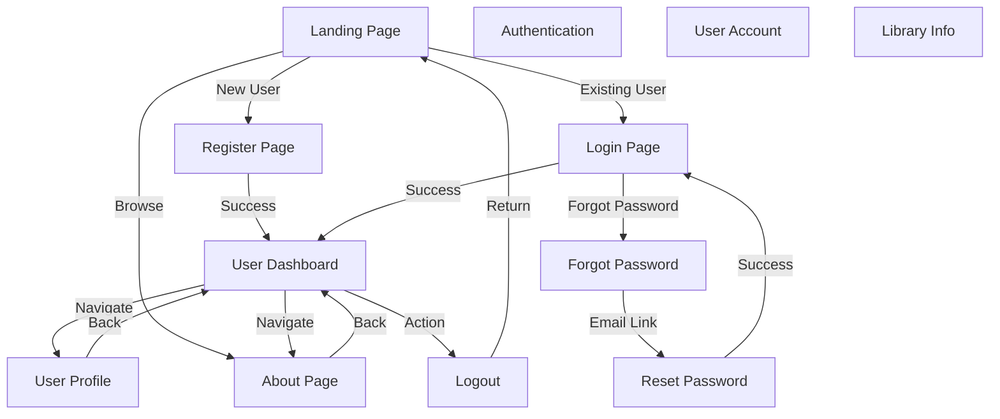
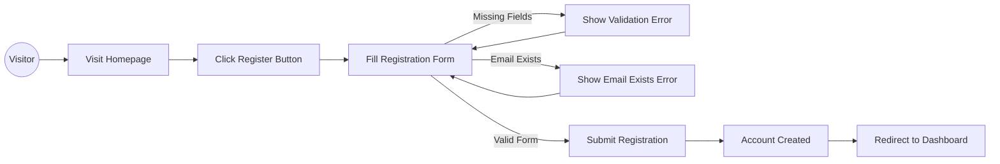
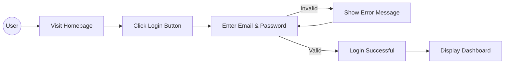
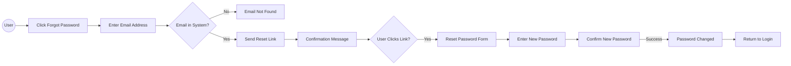

# LIBRARY SYSTEM - PROJECT DOCUMENTATION

---

## 1. PROJECT OVERVIEW

### 1.1 Introduction

The **Library Content Management System (CMS)** is a comprehensive web-based platform designed to help librarians and library staff efficiently manage the digital presence and content of a public or academic library's website. The system enables authorized personnel to update, organize, and maintain dynamic information without requiring technical expertise.

**Key Purpose:**
The primary purpose is to provide a secure, user-friendly, and efficient platform that facilitates:
- User management (registration, authentication, profile management)
- Library information dissemination (mission, vision, goals, announcements)
- Content accessibility for both staff and patrons
- Streamlined administrative operations through an intuitive dashboard

**Target Users:**
- **Librarians & Library Staff:** Personnel responsible for managing website content, user information, and system administration.
- **Library Patrons:** Individuals seeking library services, checking account status, and accessing library information.
- **Library Administrators:** Leadership responsible for oversight and strategic content updates.
- **General Public Visitors:** Guests looking for information about library hours, location, mission, and services.

**Project Type:**
This is a **Content Management System (CMS)** built as a foundational platform for library operations, emphasizing user authentication, profile management, and information organization. It serves as a scalable base for future expansions.

### 1.2 Objectives of the Website

The objectives of the Library Content Management System are to:

1. **To Inform**
   - Provide visitors with up-to-date, accurate information about the library (mission, vision, services, hours, location).
   - Display important announcements and news relevant to the library community.
   - Showcase library staff profiles and contact information.

2. **To Manage Users**
   - Enable secure user registration and authentication.
   - Provide personalized user profiles and account management.
   - Implement role-based access control for different permission levels.

3. **To Streamline Operations**
   - Allow librarians to manage and update website content through an intuitive dashboard.
   - Reduce the need for technical knowledge among non-technical staff.
   - Centralize all content management in one accessible platform.

4. **To Enhance Accessibility**
   - Ensure the website is responsive and works across all devices (desktop, tablet, mobile).
   - Provide clear, semantic HTML structure for assistive technology compatibility.
   - Maintain high contrast and readable typography standards.

5. **To Promote Library Services**
   - Highlight library programs, resources, and special collections.
   - Encourage user engagement through an attractive, professional interface.
   - Showcase the library's modern digital capability.

6. **To Ensure Security**
   - Restrict editing capabilities to authorized personnel only.
   - Implement secure authentication protocols (password hashing, session management).
   - Protect user data through CSRF protection and secure form submissions.

### 1.3 Project Scope

**Included Features:**

- **User Management:**
  - User registration with email validation
  - Secure login and logout functionality
  - Password reset and recovery via email link
  - User profile display and management
  - Account information updates
  - User booklists (personalized reading lists)

- **Pages & Content:**
  - Welcome/Landing page with clear call-to-action
  - Dashboard (protected area for authenticated users)
  - Profile page (user account information)
  - About page (library mission, vision, information)
  - Authentication pages (login, register, forgot password, reset password)
  - **NEW:** Books index page (browse all library books)
  - **NEW:** Book detail page (individual book information)
  - **NEW:** Book creation/editing pages (for authorized users)
  - **NEW:** User booklist management page
  - **NEW:** Book reading/content viewing page

- **Book Management System:** *(NEW)*
  - Add, edit, delete books with metadata
  - Book information: title, author, ISBN, category, rating
  - Cover pictures for books
  - Book availability tracking (available/unavailable)
  - Book search functionality with filters
  - Sort by rating and publication date
  - Book content file upload and management
  - Book reading interface for viewing content
  - Download book content functionality

- **User Booklist Management:** *(NEW)*
  - Create personal reading lists
  - Track reading status: "want to read", "reading", "finished"
  - Add/remove books from booklists
  - View user-specific book collections
  - Status filtering in booklists
  - Statistics on reading progress

- **Technical Features:**
  - Responsive design for desktop, tablet, and mobile devices
  - Modular Blade templating system (15+ templates)
  - Page-specific CSS organization (11 CSS files)
  - Interactive UI elements (transitions, hover effects)
  - Full-text search functionality for books
  - Advanced filtering (category, availability, ratings)
  - Pagination for book listings (12 items per page)
  - Semantic HTML5 structure for accessibility
  - Laravel CSRF protection
  - Eloquent ORM with relationships

- **Database Integration:**
  - MySQL/MariaDB database connection
  - User authentication tables
  - Books table (title, author, ISBN, category, rating, etc.)
  - Booklists table (user reading lists with status tracking)
  - Session and cache management
  - Data persistence and retrieval
  - Indexed columns for performance optimization

- **Security:**
  - Password hashing using Laravel's Hash facade
  - CSRF token protection on all forms
  - Session-based authentication
  - Input validation on all forms
  - File upload validation and storage
  - SQL injection prevention via Eloquent ORM

**Not Included (Out of Scope):**

- **Advanced Lending System:**
  - No check-out/return date tracking
  - No due date management
  - No reservation queue system
  - No fine calculations

- **Financial Features:**
  - No payment processing
  - No fine or penalty calculations
  - No fee management system

- **Advanced Features:**
  - No analytics or reporting dashboard
  - No bulk content import tools
  - No scheduled email notifications
  - No multi-language support
  - No mobile native applications
  - No SMS notification system
  - No external API integrations

**Scalability Note:**
The system is designed to be modular and extensible, with core book management now implemented. Future additions could include advanced lending features, reservation systems, analytics dashboards, and payment processing.

---

## 2. WEBSITE PLANNING

### 2.1 Site Map

The following hierarchical structure shows the organization of pages and their relationships:



### 2.2 User Flows & Storyboards

#### Flow 1: New User Registration



#### Flow 2: Returning User Login



#### Flow 3: Password Recovery



### 2.3 Wireframes

#### Homepage/Welcome Page
- Header with LibrarySystem branding
- Hero section with welcome message
- Two prominent call-to-action buttons (Register, Login)
- Footer with copyright information

#### Login Page
- Header with LibrarySystem branding
- Two-card layout: white card (left) and orange card (right, contains form)
- Email input field
- Password input field
- "Login" submit button
- "Forgot Password?" link
- "Create Account" link
- Footer with copyright

#### Dashboard Page
- Persistent header with logo, search bar, user profile section
- Fixed sidebar navigation with menu items (Home, About, Books, Edit, Bookmarks)
- Main content area with responsive layout
- Logout button in sidebar footer
- User-specific greeting

#### Registration Page
- Similar layout to login page (white + orange cards)
- Name input field
- Email input field
- Password input field
- Confirm Password input field
- "Register" submit button
- Link to login page

#### Profile Page
- Header and navigation
- User information display section
- Profile edit options
- Back to dashboard button

#### About Page
- Header and navigation
- Library mission and vision section
- Library information and contact details
- Back to dashboard button

---

## 3. DESIGN SPECIFICATIONS

### 3.1 Color Scheme & Palette

The system uses a **warm, inviting color palette** that evokes knowledge, warmth, and energy while maintaining professional standards. The palette balances warm orange/gold tones with cool professional neutrals.

**Primary Color Palette:**

| Color Name | Hex Code | RGB | Usage | Rationale |
|-----------|----------|-----|-------|-----------|
| **Primary Orange** | `#d98c19` | rgb(217, 140, 25) | Headers, primary buttons, highlights, branding | Warm, energetic, represents knowledge and approachability |
| **Primary Light Orange** | `#e8a145` | rgb(232, 161, 69) | Button hover states, secondary highlights | Lighter variation for interactive states |
| **Primary Dark Orange** | `#b37414` | rgb(179, 116, 20) | Darker accents, text on orange backgrounds | Provides depth and visual hierarchy |
| **Secondary Dark Navy** | `#2c3e50` | rgb(44, 62, 80) | Main text, headings, footers, navigation | Professional, high contrast, trustworthy |
| **Light Background** | `#f5f7fa` | rgb(245, 247, 250) | Page backgrounds, card backgrounds | Clean, modern, reduces eye strain |
| **White** | `#ffffff` | rgb(255, 255, 255) | Card surfaces, input backgrounds | Pure contrast, readability |
| **Dark Text** | `#333333` | rgb(51, 51, 51) | Body text, primary copy | High contrast for readability |
| **Muted Text** | `#666666` | rgb(102, 102, 102) | Secondary text, labels, hints | Reduced emphasis without losing visibility |
| **Light Neutral** | `#dfb87d` | rgb(223, 184, 125) | Background tones (login, register pages) | Warm neutral for visual comfort |
| **Success Green** | `#27ae60` | rgb(39, 174, 96) | Success messages, positive indicators | Conventional success indicator |
| **Error Red** | `#e74c3c` | rgb(231, 76, 60) | Error messages, validation warnings | Conventional error indicator |
| **Border Color** | `#e0e0e0` | rgb(224, 224, 224) | Form borders, dividers | Subtle separation without visual noise |
| **Shadow Color** | `rgba(0, 0, 0, 0.08)` | - | Subtle shadows on cards | Depth without darkness |
| **Shadow Hover** | `rgba(0, 0, 0, 0.12)` | - | Elevated shadows on hover | Interactive feedback |

**Color Psychology:**
- **Orange/Gold:** Represents warmth, energy, and intellectual capability—appropriate for a knowledge institution.
- **Navy Blue:** Projects stability, professionalism, and trust—essential for a system handling user data.
- **Neutrals:** Provide breathing room and reduce cognitive load, ensuring content readability.

**Usage Guidelines:**
- Use primary orange for primary CTAs and important headers
- Use navy for body text and navigation
- Use light backgrounds to reduce eye strain during extended sessions
- Use accent colors (green/red) only for status messages

### 3.2 Typography

**Font Family:**
```css
Primary: 'Segoe UI', Tahoma, Geneva, Verdana, sans-serif
Fallback: Arial, Helvetica, sans-serif
```

**Rationale:**
- Segoe UI is a system font on Windows, rendering cleanly without network overhead
- Falls back to universally available fonts for cross-platform compatibility
- Sans-serif ensures modern, clean appearance and excellent readability on screens
- Zero performance impact compared to web-hosted fonts

**Font Sizes & Hierarchy:**

| Element | Size | Weight | Usage |
|---------|------|--------|-------|
| H1 (Page Title) | 32px | Bold (700) | Main page headings |
| H2 (Section Header) | 24px | Semi-bold (600) | Section titles in content |
| H3 (Subsection) | 18px | Semi-bold (600) | Subsection headers |
| Body Text | 14-16px | Regular (400) | Paragraph content, general text |
| Button Text | 16px | Semi-bold (600) | Form buttons, CTAs |
| Navigation | 14px | Medium (500) | Menu items, links |
| Form Labels | 14px | Medium (500) | Input labels, field names |
| Small Text | 12px | Regular (400) | Help text, captions, footer |

**Font Weight Scale:**
- **400 (Regular):** Body text, default state
- **500 (Medium):** Navigation, labels, links
- **600 (Semi-bold):** Headers, section titles
- **700 (Bold):** Major headings, emphasis

**Line Height & Spacing:**
- Body text: 1.6 line-height for comfortable reading
- Headings: 1.2-1.4 line-height for compact appearance
- Letter-spacing: 0.5px on page titles for elegance
- Paragraph margins: 1em between paragraphs for visual separation

**Responsive Typography:**
- Desktop: Full sizes as specified above
- Tablet (720px): Slightly reduced (H1: 28px, Body: 15px)
- Mobile (520px): Further reduced (H1: 24px, Body: 14px)

### 3.3 Layout & Composition Principles

**Grid System:**
- **Dashboard:** CSS Grid layout (`display: grid; repeat(auto-fit, ...)`) for responsive card layouts
- **Forms:** Flexbox for vertical stacking of form elements
- **Navigation:** Flexbox for horizontal/vertical menu arrangement

**Spacing & Alignment:**
- **Base Unit:** 8px spacing scale
- **Padding:** Multiples of 8px (8px, 16px, 24px, 32px, 40px)
- **Margins:** Consistent spacing between sections
- **Gap:** 20px between items in flex/grid containers
- **Alignment:** Center-aligned main content containers with max-width constraints

**Visual Hierarchy:**
1. **Primary Elements:** Largest, brightest color (primary orange buttons)
2. **Secondary Elements:** Medium size, secondary color or emphasis
3. **Tertiary Elements:** Smaller, muted color (labels, hints)
4. **Visual Flow:** Top-to-bottom, left-to-right following natural reading order

**Balance & Contrast:**
- **Contrast:** High contrast between text and background (WCAG AA compliant minimum 4.5:1)
- **Balance:** Sidebar-main content split creates visual equilibrium
- **White Space:** Adequate margins prevent visual crowding
- **Shadow:** Subtle shadows create depth without distraction

**Responsive Design Breakpoints:**
```css
Mobile: max-width: 520px
Tablet: max-width: 720px
Desktop: 1024px and above
```

**Layout Techniques:**

1. **Flexbox Applications:**
   - Navigation menus (horizontal/vertical alignment)
   - Form layouts (vertical stacking with alignment)
   - Dashboard header (space-between logo and user section)
   - Card content (internal element alignment)

2. **Grid Applications:**
   - Dashboard content grid (responsive card layout)
   - Multi-column layouts (auto-fit, auto-fill)
   - Sidebar + main content area (fixed + flexible columns)

3. **Container Structure:**
   - Max-width containers (prevent text from becoming too wide)
   - Centered containers for balanced appearance
   - Padding wrappers for consistent margins

### 3.4 Images & Media Elements

**Icons:**
- **Font Awesome 6.4.0** library for vector icons
- **Usage:** Navigation items, search icon, user avatar, bookmark, edit, home, eye icons
- **Implementation:** `<i class="fas fa-icon-name"></i>`
- **Benefit:** Scalable, lightweight, semantic icons for improved UX

**Graphics & Styling:**
- **CSS Gradients:** Used subtly in backgrounds for visual interest
- **Emoji:** Used in dashboard (📚 for logo, 🥺 for user avatar) for casual appeal
- **Borders & Shadows:** CSS-based visual elements for depth

**Future Media Considerations:**
- **Book Covers:** Placeholder for book imagery in potential book inventory features
- **User Avatars:** Customizable user profile images (placeholder currently uses emoji)
- **Library Photography:** Space reserved for library building/space photography in About page

**Performance Considerations:**
- Vector icons (no image files needed)
- CSS-based graphics (gradients, shadows)
- Minimal external image assets
- Fast loading across all connection speeds

---

## 4. WEBSITE DEVELOPMENT

### 4.1 HTML Structure & Semantic Elements

The project uses **semantic HTML5** to ensure proper document structure, accessibility, and search engine optimization.

**Semantic HTML Elements Used:**

| Element | Purpose | Implementation |
|---------|---------|-----------------|
| `<header>` | Page header, branding, navigation | Contains LibrarySystem title, search bar, user profile |
| `<nav>` | Navigation menus | Main navigation, sidebar menu links |
| `<main>` | Primary page content | Wraps the unique content of each page |
| `<section>` | Logical content groupings | Form sections, dashboard sections |
| `<article>` | Independent content blocks | User profile info, about content |
| `<footer>` | Page footer, metadata | Copyright information, footer links |
| `<form>` | Data input containers | Login, register, password reset, search |
| `<label>` | Form field labels | Bound to inputs via `for` attribute |
| `<input>` | Form input fields | Email, password, search, name fields |
| `<button>` | Clickable actions | Submit, logout, search buttons |

**Accessibility Features:**
- **Form Labels:** All `<input>` elements have associated `<label>` tags with proper `for=""` and `id=""` attributes
- **ARIA Attributes:** Used where necessary for screen reader compatibility
- **Heading Hierarchy:** Proper `<h1>`, `<h2>`, `<h3>` structure for document outline
- **Link Text:** Descriptive link text (not just "click here")
- **Form Validation:** Client-side validation with error messages
- **Color Not Sole Indicator:** Colors combined with text/icons for meaning

**Blade Templates File Organization:**

```
resources/views/
├── about/
│   ├── about.blade.php
│   └── edit.blade.php
├── admin/
│   └── menus/
│   ├── index.blade.php
│   └── page.blade.php
├
├── auth/
│   ├── forgot-password.blade.php
│   ├── login.blade.php
│   ├── register.blade.php
│   └── reset-password.blade.php
├── bookmarks/
│   └── index.blade.php
├── books/
│   ├── bookdetail.blade.php
│   ├── bookindex.blade.php
│   ├── create.blade.php
│   ├── editbook.blade.php
│   ├── readbook.blade.php
│   └── userbooklist.blade.php
├── dashboard/
│   └── dashboard.blade.php
├── menu/
│   ├── edit.blade.php
│   ├── page.blade.php
├── news/
│   ├── create.blade.php
│   ├── edit.blade.php
│   ├── index.blade.php
│   └── show.blade.php
├── staff/
│   ├── create.blade.php
│   ├── edit.blade.php
│   └── index.blade.php
├── user/
│   └── profile.blade.php
└── welcome.blade.php
```
│   └── index.blade.php -> List of staff members
├── user/
│   └── profile.blade.php -> User profile page
└── welcome.blade.php -> Welcome page displayed after registration or login
```

**Blade Template Features:**
- **Laravel Directives:** `@auth`, `@guest`, `@csrf` for authentication and security
- **Echo Output:** `{{ $variable }}` for displaying PHP variables
- **Loops & Conditionals:** `@foreach`, `@if` for dynamic content
- **Route Helpers:** `route('name')` for safe URL generation
- **Asset Helpers:** `asset('path')` for CSS/JS file references

**Current HTML Structure Examples:**

**Login Page Structure:**
```html
<!DOCTYPE html>
<html lang="en">
<head>
    <title>LibrarySystem | Login</title>
    <link rel="stylesheet" href="css/login.css">
</head>
<body>
    <header>
        <h1>LibrarySystem</h1>
    </header>
    <main>
        <form action="/login" method="POST" class="form-container">
            @csrf
            <div class="container">
                <div class="white-back"></div>
                <div class="orange-back">
                    <!-- Form inputs here -->
                </div>
            </div>
        </form>
    </main>
    <footer class="dashboard-footer">
        <div class="copyright">&copy; 2025 LibrarySystem.</div>
    </footer>
</body>
</html>
```

**Dashboard Structure:**
```html
<header class="dashboard-header">
    <!-- Logo, Search, User Profile -->
</header>
<div class="dashboard-container">
    <nav class="sidebar">
        <!-- Navigation menu -->
    </nav>
    <main class="dashboard-content">
        <!-- Main content area -->
    </main>
</div>
```

### 4.2 CSS Structure & Styling

The project uses a **modular CSS approach** with separate stylesheets for each page and feature to maintain organization and reduce file size. All CSS files are loaded dynamically based on the rendered page.

**CSS File Organization (public/css):**

Below is a list of page-specific and feature CSS files present in `public/css/` (as requested):

- `about.css` — About page styles (`.about-header`, `.about-content`, `.about-nav`)
- `admin.css` — Admin dashboard / admin pages styles
- `book-details.css` — Book detail page styles (`.book-detail`, `.cover`, `.meta`)
- `book-index.css` — Book listing / catalog (`.book-grid`, `.filters`)
- `booklists.css` — User booklist styles (`.booklist`, `.status-badge`)
- `bookmarks.css` — Bookmark list and reading progress (`.bookmark-item`, `.last-page`)
- `create.css` — Generic create form styles
- `createnews.css` — News creation form styles
- `createStaff.css` — Staff creation form styles
- `dashboard.css` — Dashboard layout and UI (`.dashboard-header`, `.sidebar`, `.content-grid`)
- `editAbout.css` — Edit About form styles
- `editbook.css` — Edit book form styles and file inputs
- `editnews.css` — Edit news form styles
- `editStaff.css` — Edit staff form styles
- `forgot.css` — Forgot password page (`.forgot-container`)
- `login.css` — Login page styles (`.container`, `.white-back`, `.orange-back`)
- `menu-management.css` — Menu management / navigation editor styles
- `news.css` — News listing and show page styles
- `profile.css` — User profile styles (`.profile-container`, `.notification`)
- `readbook.css` — Read book view styles (pagination, text area)
- `register.css` — Registration page styles
- `reset.css` — Password reset page styles
- `showNew.css` — News detail / show page styles
- `staffIndex.css` — Staff index/listing page styles
- `welcome.css` — Landing / welcome page styles

Note: Some older or duplicate files (`style.css`, `sample.css`) remain present but the list above covers the active page styles you asked to include.

**CSS Styling Methods:**

**1. External CSS Files:**
- Separate stylesheet for each major page
- Loaded via `<link rel="stylesheet" href="asset('css/filename.css')">`
- Benefits: Modular, maintainable, clear separation of concerns

**2. CSS Variables (Custom Properties):**
```css
:root {
    --primary: #d98c19;
    --primary-light: #e8a145;
    --secondary: #2c3e50;
    --light-bg: #f5f7fa;
    --white: #ffffff;
    --text-dark: #333333;
    --text-light: #666666;
    --border-color: #e0e0e0;
    --shadow: 0 4px 12px rgba(0, 0, 0, 0.08);
}
```
- Usage: `background: var(--primary);`
- Benefits: Easy theme updates, consistent colors, reduced duplication

**3. Class-Based Styling:**
- Preferential use of classes (`.button`, `.card`) over IDs
- BEM-like naming convention (`.dashboard-header`, `.nav-link`)
- Benefits: Reusable, maintainable, avoiding specificity issues

**4. Layout Techniques:**

**Flexbox:**
```css
/* Navigation: horizontal alignment */
.dashboard-header {
    display: flex;
    justify-content: space-between;
    align-items: center;
}

/* Form: vertical stacking */
.form-container {
    display: flex;
    flex-direction: column;
    gap: 20px;
}

/* Search bar: internal layout */
.search-container {
    display: flex;
    align-items: center;
    gap: 10px;
}
```
- **Use Case:** One-dimensional layouts (rows or columns)
- **Benefits:** Simple alignment, responsive behavior, no wrapper div needed

**CSS Grid:**
```css
/* Dashboard content: responsive multi-column */
.content-grid {
    display: grid;
    grid-template-columns: repeat(auto-fit, minmax(300px, 1fr));
    gap: 20px;
}
```
- **Use Case:** Two-dimensional layouts (rows AND columns)
- **Benefits:** Responsive without media queries, complex layouts, content-driven sizing

**Flexbox vs Grid Decision Matrix:**
- Use **Flexbox** for: navigation, form inputs, header sections, linear layouts
- Use **Grid** for: dashboard cards, multi-column content, complex 2D arrangements

**5. Responsive Design:**
```css
/* Mobile first */
@media (max-width: 520px) {
    .container { flex-direction: column; }
    .sidebar { display: none; } /* Hidden on mobile */
}

@media (max-width: 720px) {
    .search-section { max-width: 100%; }
    .logo-text { font-size: 18px; }
}
```

**6. Interactive States:**
```css
/* Hover effects */
.nav-link:hover {
    background-color: var(--primary-light);
    transition: all 0.3s ease;
}

/* Focus states (keyboard navigation) */
input:focus {
    outline: 2px solid var(--primary);
    border-color: var(--primary);
}

/* Active states */
.nav-link.active {
    border-left: 4px solid var(--primary);
    background-color: rgba(217, 140, 25, 0.1);
}
```

**Styling Architecture:**
```
dashboard.css Structure:
├── Reset & Base Styles (*, body)
├── CSS Variables (:root)
├── Header Styles (.dashboard-header)
├── Sidebar Styles (.sidebar, .nav-menu, .nav-link)
├── Main Content Styles (.dashboard-content, .content-grid)
├── Card Styles (.card, .card-header)
├── Footer Styles (.dashboard-footer)
├── Responsive Media Queries (@media)
└── Animation/Transition States
```

### 4.3 JavaScript Implementation

**JavaScript File Organization:**

| File | Purpose | Size | Status |
|------|---------|------|--------|
| `book.js` | Book animation logic | 1,069 lines | Primarily commented/unused (dev exploration) |
| `login.js` | Login page interactions | ~100 lines | Event handlers, form validation |
| `register.js` | Register page interactions | ~100 lines | Form validation, submission |
| `forgot.js` | Forgot password interactions | ~80 lines | Email validation, form handling |
| `sample.js` | Testing/demo script | ~50 lines | Development testing |

**Key JavaScript Features:**

1. **Form Validation:**
   - Real-time field validation
   - Error message display
   - Submit prevention on invalid data

2. **Event Handling:**
   - Button click handlers
   - Form submission listeners
   - Link navigation

3. **DOM Manipulation:**
   - Dynamic class additions (`.active`, `.error`)
   - Content insertion and removal
   - Style toggles

**Accessibility in JavaScript:**
- Maintains focus management
- Keyboard support (Enter to submit, Escape to close modals)
- ARIA updates for dynamic content
- No JavaScript-dependent critical functionality

### 4.4 Database Integration

**Database System:** MySQL/MariaDB

**Key Tables:**

**Core Tables:**
- `users` - User accounts and authentication
- `personal_access_tokens` - API tokens (for future use)
- `cache` - Session and cache management
- `jobs` - Job queue support

**Application Tables:**
- `profiles` - User profile information (relation to users)
- `abouts` - Library about/information content
- `books` - Library book catalog *(NEW)*
- `booklists` - User reading lists and book tracking *(NEW)*

**Books Table Schema:** *(NEW)*
```sql
CREATE TABLE books (
    id BIGINT PRIMARY KEY,
    title VARCHAR(255),
    author VARCHAR(255),
    description TEXT,
    cover_picture VARCHAR(255),
    rating DECIMAL(3,2) DEFAULT 0.00,
    total_copies INT DEFAULT 1,
    available_copies INT DEFAULT 1,
    isbn VARCHAR(255) UNIQUE,
    publisher VARCHAR(255),
    publication_year INT,
    category VARCHAR(255),
    language VARCHAR(50) DEFAULT 'English',
    pages INT,
    status ENUM('available', 'unavailable') DEFAULT 'available',
    content_file VARCHAR(255),  -- File path for book content
    timestamps,
    INDEXES: title, author, category, status
)
```

**Booklists Table Schema:** *(NEW)*
```sql
CREATE TABLE booklists (
    id BIGINT PRIMARY KEY,
    user_id BIGINT (foreign key to users),
    book_id BIGINT (foreign key to books),
    status ENUM('want_to_read', 'reading', 'finished') DEFAULT 'want_to_read',
    date_added TIMESTAMP,
    timestamps,
    UNIQUE(user_id, book_id)  -- Prevent duplicate entries
)
```

**Eloquent Models:**
```
app/Models/
├── User.php          # User model with factory
├── Profile.php       # User profile model
├── About.php         # Library about/information model
├── Book.php          # Book catalog model (NEW)
└── Booklist.php      # User booklists model (NEW)
```

**Authentication System:**
- Password hashing: Laravel's `Hash::make()`
- Session management: Laravel's session middleware
- CSRF protection: `@csrf` Blade directive
- Remember me: Optional persistent login

**File Upload Handling:** *(NEW)*
- Book cover pictures stored in `storage/app/public/books/covers/`
- Book content files stored in `storage/app/public/books/content/`
- File validation on upload (type, size)
- Secure file access control

### 4.5 File Organization Reference

**Complete Project Structure:**

```
library_system/
├── app/
│   ├── Http/
│   │   ├── Controllers/
│   │   │   ├── AuthController.php        # Auth routes handling
│   │   │   ├── ProfileController.php     # User profile
│   │   │   ├── AboutController.php       # About page
│   │   │   ├── UserController.php        # Dashboard display (NEW)
│   │   │   ├── BookController.php        # Book CRUD & search (NEW)
│   │   │   ├── BooklistController.php    # User booklists (NEW)
│   │   │   ├── ForgotPasswordController.php # Password reset request (NEW)
│   │   │   └── ResetPasswordController.php  # Password reset completion (NEW)
│   │   └── Requests/                     # Form validation
│   ├── Models/
│   │   ├── User.php                      # User model
│   │   ├── Profile.php                   # Profile model
│   │   ├── About.php                     # About model
│   │   ├── Book.php                      # Book model (NEW)
│   │   └── Booklist.php                  # Booklist model (NEW)
│   └── Policies/
│       ├── UserPolicy.php
│       ├── ProfilePolicy.php
│       └── AboutPolicy.php
├── bootstrap/
│   ├── app.php                           # App bootstrapping
│   └── providers.php                     # Service provider loading
├── config/
│   ├── app.php                           # Application config
│   ├── auth.php                          # Auth guards & providers
│   ├── database.php                      # Database config
│   └── [other configs]                   # Various configs
├── database/
│   ├── factories/
│   │   ├── UserFactory.php               # User model factory
│   │   ├── ProfileFactory.php            # Profile factory
│   │   └── AboutFactory.php              # About factory
│   ├── migrations/
│   │   ├── 0001_01_01_000000_create_users_table.php
│   │   ├── 0001_01_01_000001_create_cache_table.php
│   │   ├── 0001_01_01_000002_create_jobs_table.php
│   │   ├── 2025_12_04_140305_create_profiles_table.php
│   │   ├── 2025_12_04_142631_create_abouts_table.php
│   │   ├── 2025_12_06_123952_create_personal_access_tokens_table.php
│   │   ├── 2025_12_08_064114_create_books_table.php (NEW)
│   │   ├── 2025_12_09_172831_create_booklists_table.php (NEW)
│   │   └── 2025_12_11_005708_add_content_file_to_books_table.php (NEW)
│   └── seeders/
│       ├── DatabaseSeeder.php            # Main seeder
│       ├── UserSeeder.php                # User data
│       ├── ProfileSeeder.php             # Profile data
│       └── AboutSeeder.php               # About data
├── public/
│   ├── css/
│   │   ├── dashboard.css                 # Dashboard styles
│   │   ├── login.css                     # Login page styles
│   │   ├── register.css                  # Register page styles
│   │   ├── forgot.css                    # Forgot password styles
│   │   ├── reset.css                     # Reset password styles
│   │   ├── welcome.css                   # Welcome page styles
│   │   ├── about.css                     # About page styles (NEW)
│   │   ├── editAbout.css                 # Edit About page styles (NEW)
│   │   ├── profile.css                   # Profile page styles (NEW)
│   │   ├── books.css                     # Books listing styles (NEW)
│   │   ├── style.css                     # Global styles (empty)
│   │   └── sample.css                    # Test stylesheet
│   ├── js/
│   │   ├── book.js                       # Book animation (dev)
│   │   ├── login.js                      # Login interactions
│   │   ├── register.js                   # Register interactions
│   │   ├── forgot.js                     # Forgot password interactions
│   │   └── sample.js                     # Test script
│   ├── index.php                         # Entry point
│   └── robots.txt                        # SEO robots directives
├── resources/
│   ├── views/
│   │   ├── welcome.blade.php             # Welcome page
│   │   ├── auth/
│   │   │   ├── login.blade.php           # Login form (with welcome message & emoji)
│   │   │   ├── register.blade.php        # Register form
│   │   │   ├── forgot-password.blade.php # Forgot form
│   │   │   └── reset-password.blade.php  # Reset form
│   │   ├── dashboard/
│   │   │   └── dashboard.blade.php       # Dashboard interface
│   │   ├── user/
│   │   │   └── profile.blade.php         # User profile
│   │   ├── about/
│   │   │   └── about.blade.php           # About page
│   │   └── books/                        # NEW - Book management
│   │       ├── bookindex.blade.php       # Books listing page
│   │       ├── bookdetail.blade.php      # Book detail view
│   │       ├── create.blade.php          # Book creation form (alt)
│   │       ├── createbook.blade.php      # Book creation form (primary)
│   │       ├── editbook.blade.php        # Book editing form
│   │       ├── readbook.blade.php        # Book reading interface
│   │       └── userbooklist.blade.php    # User's personal reading lists
│   ├── css/
│   │   └── app.css                       # Compiled CSS (Vite)
│   └── js/
│       ├── app.js                        # Main JS file
│       └── bootstrap.js                  # Bootstrap utilities
├── routes/
│   ├── web.php                           # Web routes (GET, POST)
│   ├── api.php                           # API routes (future)
│   └── console.php                       # Console commands
├── storage/
│   ├── app/
│   │   ├── private/                      # Private uploads
│   │   └── public/                       # Public uploads
│   ├── framework/
│   │   ├── cache/                        # Framework cache
│   │   └── sessions/                     # Session data
│   └── logs/
│       └── laravel.log                   # Application logs
├── tests/
│   ├── TestCase.php                      # Base test class
│   ├── Feature/                          # Feature tests
│   └── Unit/                             # Unit tests
├── vendor/                               # Composer dependencies
├── .env                                  # Environment variables
├── .gitignore                            # Git ignore rules
├── composer.json                         # PHP dependencies
├── composer.lock                         # Locked dependencies
├── package.json                          # Node dependencies4
├── vite.config.js                        # Vite build config
├── phpunit.xml                           # PHPUnit configuration
├── artisan                               # Artisan CLI tool
└── DOCUMENTATION.md                      # Project documentation
```

---

## 5. ROUTES & CONTROLLERS

### 5.1 Web Routes

All web routes are defined in `routes/web.php`. The system includes comprehensive routing for authentication, dashboard, books, and booklists:

**Authentication Routes:**

| Method | Route | Controller | Purpose |
|--------|-------|-----------|----------|
| GET | `/librarysystem/register` | AuthController@showRegister | Show registration form |
| POST | `/librarysystem/register` | AuthController@register | Process registration |
| GET | `/librarysystem/login` | AuthController@showLogin | Show login form |
| POST | `/librarysystem/login` | AuthController@login | Process login |
| POST | `/librarysystem/logout` | AuthController@logout | Logout user |

**Password Recovery Routes:**

| Method | Route | Controller | Purpose |
|--------|-------|-----------|----------|
| GET | `/forgot-password` | ForgotPasswordController@showLinkForm | Show password reset request |
| POST | `/forgot-password` | ForgotPasswordController@sendResetLink | Send password reset email |
| GET | `/reset-password/{token}` | ResetPasswordController@showResetForm | Show password reset form |
| POST | `/reset-password` | ResetPasswordController@resetPassword | Process password reset |

**Dashboard & Profile Routes:**

| Method | Route | Controller | Purpose |
|--------|-------|-----------|----------|
| GET | `/` | - | Display welcome page |
| GET | `/librarysystem/dashboard` | UserController@index | Show user dashboard (protected) |
| GET | `/librarysystem/profile` | ProfileController@index | Display user profile (protected) |
| PUT | `/librarysystem/profile` | ProfileController@update | Update user profile (protected) |

**About Page Routes:**

| Method | Route | Controller | Purpose |
|--------|-------|-----------|----------|
| GET | `/librarysystem/about` | AboutController@index | Display about page |
| GET | `/librarysystem/about/edit` | AboutController@edit | Edit about page (protected) |
| PUT | `/librarysystem/about/update` | AboutController@update | Update about page (protected) |
| GET | `/librarysystem/api/about` | AboutController@getAboutData | Get about data via API |

**Book Management Routes (Resource Routes):**

| Method | Route | Controller | Purpose |
|--------|-------|-----------|----------|
| GET | `/books` | BookController@index | List all books with search/filter |
| GET | `/books/create` | BookController@create | Show create book form (protected) |
| POST | `/books` | BookController@store | Store new book (protected) |
| GET | `/books/{book}` | BookController@show | Show book detail |
| GET | `/books/{book}/edit` | BookController@edit | Edit book form (protected) |
| PUT | `/books/{book}` | BookController@update | Update book (protected) |
| DELETE | `/books/{book}` | BookController@destroy | Delete book (protected) |
| GET | `/books/{book}/read` | BookController@readContent | Read book content |
| GET | `/books/{book}/download` | BookController@downloadContent | Download book file |

**User Booklist Routes (Authenticated):**

| Method | Route | Controller | Purpose |
|--------|-------|-----------|----------|
| GET | `/booklists` | BooklistController@index | View user's booklists (protected) |
| POST | `/booklists` | BooklistController@store | Add book to booklist (protected) |
| PUT | `/booklists/{booklist}` | BooklistController@update | Update booklist status (protected) |
| DELETE | `/booklists/{booklist}` | BooklistController@destroy | Remove book from booklist (protected) |
| GET | `/booklists/stats` | BooklistController@stats | Get booklist statistics (protected) |

### 5.2 Controllers

**AuthController:**
- `showRegister()` - Display registration form
- `register()` - Validate & create user account
- `showLogin()` - Display login form
- `login()` - Authenticate user
- `logout()` - End user session

**ForgotPasswordController:**
- `showLinkForm()` - Display password reset request form
- `sendResetLink()` - Send password reset email

**ResetPasswordController:**
- `showResetForm()` - Display password reset form
- `resetPassword()` - Process password reset

**UserController:**
- `index()` - Display authenticated user dashboard

**ProfileController:**
- `index()` - Display user profile
- `update()` - Update user profile information

**AboutController:**
- `index()` - Display about page
- `edit()` - Show edit form for about page
- `update()` - Update about page content
- `getAboutData()` - Retrieve about data via API

**BookController:** *(NEW)*
- `index()` - List all books with search and filtering
- `create()` - Show create book form
- `store()` - Store new book to database
- `show()` - Display book detail page
- `edit()` - Show edit book form
- `update()` - Update book information
- `destroy()` - Delete a book
- `readContent()` - Display book reading interface
- `downloadContent()` - Download book file

**BooklistController:** *(NEW)*
- `index()` - List user's personal booklists with filtering
- `store()` - Add book to user's booklist
- `update()` - Update booklist status (want_to_read, reading, finished)
- `destroy()` - Remove book from booklist
- `stats()` - Get statistics on reading progress

### 5.3 Models & Relationships

**User Model:**
- `hasMany('Profile')` - One user has multiple profiles (if applicable)
- `hasMany('Booklist')` - One user has many booklists
- Timestamps enabled
- Password automatically hashed
- Uses Laravel's `HasFactory`

**Profile Model:**
- `belongsTo('User')` - Each profile belongs to a user
- Stores additional user information

**About Model:**
- Stores library/about page information
- Editable by administrators

**Book Model:** *(NEW)*
- Attributes: title, author, description, cover_picture, rating, total_copies, available_copies, ISBN, publisher, publication_year, category, language, pages, status, content_file
- Relationships: `hasMany('Booklist')` - Books can be added to multiple booklists
- Query scopes: `search()`, `byCategory()`, `available()`
- Indexes on: title, author, category, status for performance

**Booklist Model:** *(NEW)*
- Attributes: user_id, book_id, status (want_to_read, reading, finished), date_added
- Relationships: 
  - `belongsTo('User')` - Each booklist entry belongs to a user
  - `belongsTo('Book')` - Each booklist entry references a book
- Query scopes: `byStatus()` - Filter by reading status
- Unique constraint: user_id + book_id (no duplicate entries)

---

## 6. SECURITY & BEST PRACTICES

### 6.1 Authentication & Authorization

- **Password Hashing:** Uses Laravel's `Hash` facade with bcrypt
- **Session Management:** Encrypted, HTTP-only cookies
- **CSRF Protection:** Token validation on all POST requests
- **Email Verification:** Can be enabled for registration (currently optional)

### 6.2 Data Protection

- **Input Validation:** All inputs validated on server-side
- **SQL Injection Prevention:** Uses Eloquent ORM parameterized queries
- **XSS Prevention:** Blade template auto-escaping
- **Sensitive Data:** Environment variables via `.env` file

### 6.3 Responsive Design

- **Mobile-First Approach:** Starts with mobile styles, progressively enhanced
- **Flexible Layouts:** Flexbox & Grid adapt to all screen sizes
- **Touch-Friendly:** Adequate button/link sizes for touch input
- **Performance:** Optimized CSS, minimal JavaScript

---

## 7. ACCESSIBILITY & COMPLIANCE

### 7.1 WCAG 2.1 Compliance

- **Color Contrast:** Minimum 4.5:1 contrast ratio for text
- **Keyboard Navigation:** All interactive elements keyboard accessible
- **Screen Reader Support:** Semantic HTML & ARIA labels
- **Focus Management:** Visible focus indicators on all interactive elements
- **Readable Typography:** Adequate font sizes and line-height

### 7.2 Browser Support

- Chrome (latest)
- Firefox (latest)
- Safari (latest)
- Edge (latest)
- Mobile browsers (iOS Safari, Chrome Mobile)

---

## 8. PERFORMANCE OPTIMIZATION

### 8.1 Frontend Optimization

- **CSS Organization:** Modular stylesheets reduce file size
- **System Fonts:** No web font overhead (uses system fonts)
- **Icon Library:** Vector icons (Font Awesome) are lightweight
- **Image Optimization:** Minimal images, CSS gradients where possible
- **Minification:** CSS/JS minified in production builds (Vite)

### 8.2 Backend Optimization

- **Query Optimization:** Uses Eloquent relationships to prevent N+1 queries
- **Caching:** Framework caching for session data
- **Database Indexing:** Indexed columns for faster queries

---

## 9. FUTURE ENHANCEMENTS

### 9.1 Planned Features (Post-MVP)

- **Book Inventory System:**
  - Add, edit, delete books
  - Book metadata (ISBN, author, genre, year)
  - Book search and filtering

- **Lending System:**
  - Borrow/return tracking
  - Due date management
  - Reservation system

- **Notifications:**
  - Email notifications for events
  - In-app notifications
  - Overdue reminders

- **Advanced Admin Panel:**
  - User management interface
  - Content management dashboard
  - Analytics and reporting

- **Multi-Language Support:**
  - Localization framework setup
  - Translations for UI text

- **Payment Processing:**
  - Fine payment system
  - Membership fees (if applicable)

### 9.2 Architecture Improvements

- **API Layer:** RESTful API for future mobile apps
- **Microservices:** Separation of concerns (auth service, book service, etc.)
- **Caching Strategy:** Redis for session/data caching
- **Testing:** Comprehensive PHPUnit & Pest tests
- **CI/CD:** Automated testing and deployment pipeline

---

## 10. DEPLOYMENT & MAINTENANCE

### 10.1 Development Environment

**Requirements:**
- PHP 8.2+
- Composer 2.0+
- MySQL 8.0+ or MariaDB 10.3+
- Node.js 18+ (for Vite builds)

**Setup:**
```bash
composer install
npm install
npm run dev
php artisan migrate
php artisan serve
```

### 10.2 Production Deployment

**Pre-Deployment:**
```bash
composer install --no-dev
npm run build
php artisan config:cache
php artisan route:cache
php artisan view:cache
```

**Server Requirements:**
- Apache/Nginx web server
- PHP 8.2+ CLI
- MySQL 8.0+
- SSL certificate

### 10.3 Maintenance

- Regular database backups
- Log monitoring and review
- Security patch application
- Performance monitoring
- User support and troubleshooting

---

## 11. BOOK MANAGEMENT SYSTEM (NEW)

The system now includes a comprehensive book management module with the following capabilities:

### 11.1 Book Catalog Features

**Book Creation & Management:**
- Add new books with metadata (title, author, ISBN, category, etc.)
- Upload book cover pictures
- Upload book content files (PDF, EPUB, etc.)
- Edit existing book information
- Delete books from catalog
- Track availability and stock count

**Book Information Tracked:**
- Title (required)
- Author (required)
- Description (optional, rich text)
- Cover picture (optional, image upload)
- ISBN (optional, unique identifier)
- Publisher (optional)
- Publication year (optional)
- Category (optional, for filtering)
- Language (default: English)
- Page count (optional)
- Rating (0-5 stars, decimal)
- Total copies in library
- Available copies count
- Status (available/unavailable)
- Content file (for reading feature)

**Book Search & Discovery:**
- Full-text search by title, author, ISBN
- Filter by category
- Filter by availability status
- Sort by rating (highest first)
- Sort by publication date (newest first)
- Pagination (12 items per page)
- Advanced search combining multiple filters

### 11.2 User Booklist Features

**Reading List Management:**
- Add books to personal reading lists
- Track reading status (want_to_read, reading, finished)
- Update status as user progresses
- Remove books from list
- View all personal booklists
- Filter booklists by status
- Prevent duplicate entries (unique user + book combination)

**Reading Statistics:**
- Count of books in each status category
- Progress tracking across user's library
- Viewing reading statistics endpoint

### 11.3 Book Content Viewing

**Reading Interface:**
- View book content in browser (readbook page)
- Display book metadata while reading
- Download book files for offline reading
- Responsive reading layout
- Navigation controls for content

---

## CONCLUSION

The **Library Content Management System** is a well-architected, secure, and user-friendly platform built on Laravel's robust framework. It successfully achieves its objectives of providing an accessible interface for library staff to manage digital content, enabling patrons to access library services, and maintaining high security standards for user data.

**Key Strengths:**
- ✅ Secure authentication system with proper validation
- ✅ Comprehensive book management system with search and filtering
- ✅ User reading list tracking with status management
- ✅ Responsive, accessible design suitable for all devices
- ✅ Modular, maintainable code structure
- ✅ Professional, warm color scheme evoking trust and approachability
- ✅ Clear information hierarchy and user flows
- ✅ Foundation for future expansion and features

**Current Capabilities:**
The system currently provides user registration, authentication, profile management, library information display, complete book catalog management, user reading lists, and a secure dashboard—establishing a comprehensive library operations platform.

**Scalability:**
The modular architecture allows for seamless integration of future features such as advanced lending systems, reservation queues, analytics dashboards, payment processing, and mobile applications.

**Vision:**
This project represents the modern digital transformation of library services, positioning the institution as technologically progressive while maintaining the warmth and accessibility that libraries represent in their communities.

---

**Project Version:** 2.0 (December 2025)
**Framework:** Laravel 12
**Last Updated:** December 11, 2025
**Status:** Active Development - Book Management Implemented

